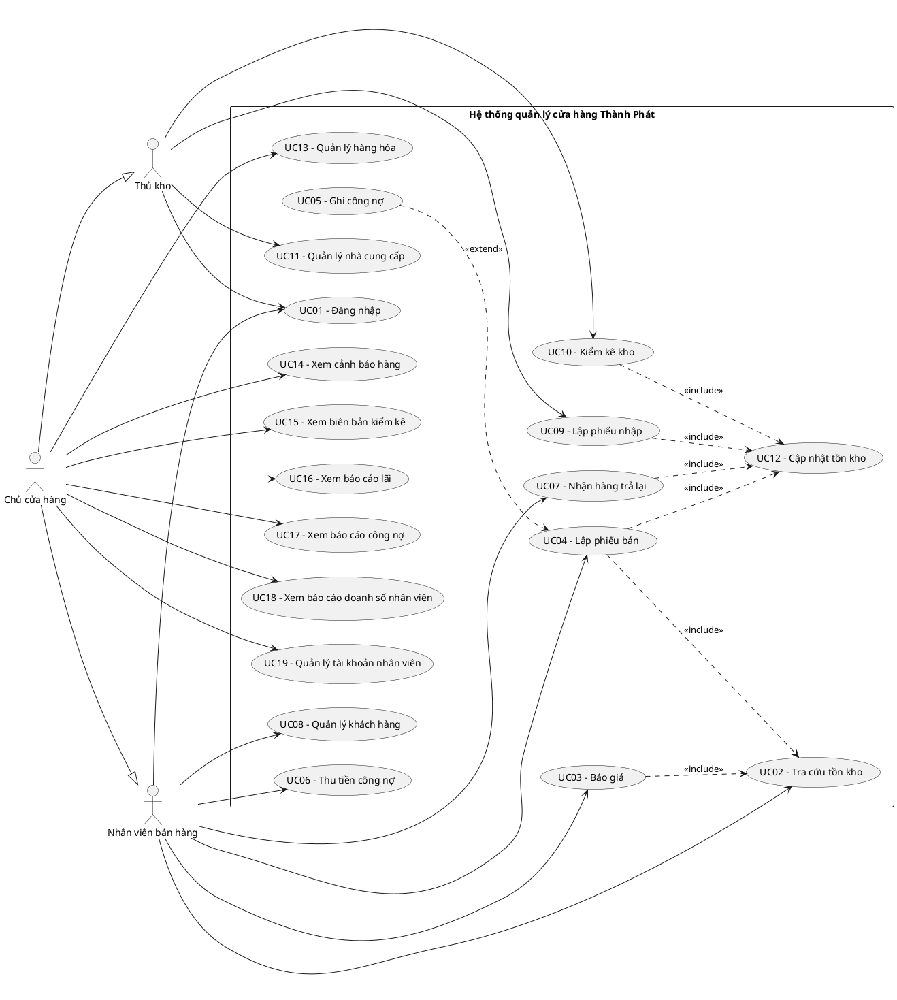

<!--
  Đặc tả Use Case cho Hệ thống quản lý cửa hàng Thành Phát.
  Gồm: tổng quan, tác nhân, sơ đồ PlantUML, quy tắc nghiệp vụ, đặc tả chi tiết 6 Use Case quan trọng và câu hỏi mở.
  Sơ đồ gốc: docs/usecase/quan-ly-cua-hang-thanh-phat.puml
-->

# Đặc tả Use Case – Hệ thống quản lý cửa hàng Thành Phát

## 1. Tổng quan
- **Mục tiêu:** Số hóa việc bán hàng, công nợ, nhập hàng theo lô và kiểm kho cho cửa hàng cơ khí và vật tư xây dựng Thành Phát. Nhờ đó chủ biết được tiền lãi, ai còn nợ và nhân viên nào bán nhiều nhất.
- **Quy mô:** 4 người dùng (1 chủ, 2 nhân viên bán hàng, 1 thủ kho), khoảng 40–60 lượt khách mỗi ngày.
- **Ngoài phạm vi:** khách tự đặt hàng online, hóa đơn điện tử, kết nối ngân hàng, tính lương thưởng, công nợ phải trả cho nhà cung cấp.

## 2. Tác nhân
| Tác nhân | Vai trò |
|---|---|
| Nhân viên bán hàng | Tra hàng, báo giá, lập phiếu bán, thu nợ, nhận hàng trả lại, quản lý khách hàng |
| Thủ kho | Lập phiếu nhập, kiểm kê kho, quản lý nhà cung cấp |
| Chủ cửa hàng | Kế thừa toàn bộ quyền của 2 vai trò trên, thêm quyền quản lý hàng hóa, xem cảnh báo, xem báo cáo, quản lý tài khoản |

Khách hàng và nhà cung cấp chỉ là dữ liệu trong hệ thống, họ không đăng nhập.

## 3. Sơ đồ Use Case

## 4. Quy tắc nghiệp vụ chung
| Mã | Quy tắc |
|---|---|
| BR01 | Mỗi đơn vị tính là **một món hàng riêng**, có giá bán và tồn kho riêng, không quy đổi qua lại. Ví dụ: "Ốc M8 (con)" và "Ốc M8 (kg)" là 2 món khác nhau. |
| BR02 | Giá vốn tính theo **FIFO** (nhập trước xuất trước): bán thì trừ lô nhập cũ nhất trước, giá vốn lấy theo giá nhập của lô đó. |
| BR03 | Khách lẻ trả tiền ngay. Khách thầu được ghi nợ, thanh toán cuối tháng. |
| BR04 | Công nợ ghi theo từng phiếu bán, lưu số tiền và ngày phát sinh nợ. |
| BR05 | "Sắp hết": tồn ≤ 10, dùng chung cho mọi món. "Tồn lâu": 180 ngày không bán được lần nào. |
| BR06 | Chỉ nhận lại hàng còn nguyên. Khách thầu thì trừ vào công nợ, khách lẻ thì hoàn tiền mặt. |
| BR07 | Kiểm kê bị lệch thì hệ thống tự điều chỉnh tồn ngay và lưu biên bản để chủ xem sau. |
| BR08 | Mỗi phiếu bán ghi lại nhân viên lập phiếu, dùng để tính doanh số. |

## 5. Đặc tả chi tiết

### UC04 – Lập phiếu bán
| Mục | Nội dung |
|---|---|
| Mã – Tên | UC04 – Lập phiếu bán |
| Tác nhân chính / phụ | Nhân viên bán hàng (Chủ cũng làm được) / không có |
| Mô tả | Ghi nhận một lần bán hàng: trừ tồn kho, thu tiền hoặc ghi nợ, ghi doanh số cho nhân viên. |
| Sự kiện kích hoạt | Khách đồng ý mua sau khi được báo giá. |
| Điều kiện trước | Nhân viên đã đăng nhập (UC01). Món hàng đã có trong danh mục (UC13). |
| Điều kiện sau | Phiếu bán được lưu. Tồn kho giảm theo FIFO (UC12). Khách lẻ thì ghi đã thu tiền, khách thầu thì ghi công nợ (UC05). Doanh số được ghi cho nhân viên lập phiếu. |
| Luồng chính | 1. Nhân viên tạo phiếu bán mới → Hệ thống hiển thị phiếu trống, ghi sẵn tên nhân viên và ngày. 2. Nhân viên chọn khách hàng, hoặc chọn "Khách lẻ" → Hệ thống hiển thị loại khách. 3. Nhân viên tìm món hàng → Hệ thống hiển thị giá và tồn hiện tại (UC02). 4. Nhân viên nhập số lượng → Hệ thống kiểm tra tồn và tính thành tiền. 5. Lặp lại bước 3–4 cho các món khác → Hệ thống cập nhật tổng tiền. 6. Nhân viên bấm "Lưu phiếu" → Hệ thống lưu phiếu, trừ tồn theo FIFO (UC12). 7. Khách lẻ: nhân viên xác nhận đã thu tiền → Hệ thống ghi phiếu "Đã thanh toán". |
| Luồng thay thế | **7a.** Khách là thầu → Hệ thống ghi công nợ cho khách, gồm số tiền và ngày (UC05). Phiếu ở trạng thái "Ghi nợ". **2a.** Khách thầu chưa có trong hệ thống → Nhân viên thêm khách mới (UC08) rồi quay lại bước 2. |
| Ngoại lệ | **4e.** Số lượng vượt tồn → Hệ thống báo "Không đủ hàng, còn X" và không cho lưu dòng đó. **6e.** Khách đổi ý → Nhân viên hủy phiếu, tồn kho không đổi. |
| Quy tắc nghiệp vụ | BR01, BR02, BR03, BR04, BR08 |

### UC06 – Thu tiền công nợ
| Mục | Nội dung |
|---|---|
| Mã – Tên | UC06 – Thu tiền công nợ |
| Tác nhân chính / phụ | Nhân viên bán hàng (Chủ cũng làm được) / không có |
| Mô tả | Ghi nhận khoản tiền khách thầu thanh toán và giảm số nợ tương ứng. |
| Sự kiện kích hoạt | Khách thầu đến thanh toán, thường vào cuối tháng. |
| Điều kiện trước | Đã đăng nhập. Khách đang có công nợ lớn hơn 0. |
| Điều kiện sau | Phiếu thu được lưu và công nợ của khách giảm. |
| Luồng chính | 1. Nhân viên chọn khách → Hệ thống hiển thị tổng nợ và danh sách phiếu nợ kèm ngày nợ. 2. Nhân viên nhập số tiền khách trả → Hệ thống kiểm tra số tiền. 3. Nhân viên bấm "Lưu" → Hệ thống tạo phiếu thu, trừ dần vào các phiếu nợ cũ nhất trước, rồi hiển thị số nợ còn lại. |
| Luồng thay thế | **2a.** Khách trả một phần → Hệ thống trừ phần đã trả, phần nợ còn lại giữ nguyên ngày nợ cũ. |
| Ngoại lệ | **2e.** Số tiền trả lớn hơn tổng nợ → Hệ thống báo lỗi và yêu cầu nhập lại. |
| Quy tắc nghiệp vụ | BR04 · **Câu hỏi mở:** có trừ vào phiếu nợ cũ nhất trước không? Có giới hạn số tiền nợ tối đa không? |

### UC07 – Nhận hàng trả lại
| Mục | Nội dung |
|---|---|
| Mã – Tên | UC07 – Nhận hàng trả lại |
| Tác nhân chính / phụ | Nhân viên bán hàng (Chủ cũng làm được) / không có |
| Mô tả | Nhận lại hàng khách đã mua, cộng hàng vào kho và trừ công nợ hoặc hoàn tiền. |
| Sự kiện kích hoạt | Khách mang hàng đến trả. |
| Điều kiện trước | Đã đăng nhập. Có phiếu bán gốc chứa món hàng được trả. |
| Điều kiện sau | Phiếu trả hàng được lưu. Tồn kho tăng (UC12). Công nợ giảm hoặc đã hoàn tiền. Doanh số của nhân viên lập phiếu gốc giảm tương ứng. |
| Luồng chính | 1. Nhân viên tìm phiếu bán gốc → Hệ thống hiển thị các món đã bán. 2. Nhân viên kiểm tra hàng còn nguyên, chọn món và số lượng trả → Hệ thống tính số tiền trả lại theo giá đã bán. 3. Nhân viên bấm "Lưu" → Hệ thống cộng tồn kho (UC12) và trừ vào công nợ của khách thầu. |
| Luồng thay thế | **3a.** Khách lẻ → Hệ thống ghi "Hoàn tiền mặt" kèm số tiền. |
| Ngoại lệ | **2e.** Hàng không còn nguyên → Nhân viên từ chối, không tạo phiếu. **2e2.** Số lượng trả vượt số đã mua → Hệ thống báo lỗi. |
| Quy tắc nghiệp vụ | BR06 · **Câu hỏi mở:** hàng trả lại thì nhập vào lô nào để tính giá vốn? Có giới hạn số ngày được trả hàng không? |

### UC09 – Lập phiếu nhập
| Mục | Nội dung |
|---|---|
| Mã – Tên | UC09 – Lập phiếu nhập |
| Tác nhân chính / phụ | Thủ kho (Chủ cũng làm được) / không có |
| Mô tả | Ghi nhận một lô hàng nhập từ nhà cung cấp, kèm giá nhập riêng của lô đó. |
| Sự kiện kích hoạt | Hàng từ nhà cung cấp về tới cửa hàng. |
| Điều kiện trước | Đã đăng nhập. Nhà cung cấp và món hàng đã có trong hệ thống. |
| Điều kiện sau | Phiếu nhập được lưu. Mỗi dòng hàng tạo thành một **lô** mới, có giá nhập và ngày nhập. Tồn kho tăng (UC12). |
| Luồng chính | 1. Thủ kho tạo phiếu nhập và chọn nhà cung cấp → Hệ thống hiển thị phiếu trống. 2. Thủ kho chọn món, nhập số lượng và giá nhập → Hệ thống tính thành tiền. 3. Lặp lại bước 2 cho các món khác → Hệ thống tính tổng phiếu. 4. Thủ kho bấm "Lưu" → Hệ thống tạo các lô mới và cộng tồn (UC12). |
| Luồng thay thế | **1a.** Nhà cung cấp mới → Thủ kho thêm nhà cung cấp (UC11) rồi quay lại. **2a.** Món hàng mới → Báo chủ thêm món vào danh mục (UC13). |
| Ngoại lệ | **2e.** Số lượng hoặc giá nhập ≤ 0 → Hệ thống báo lỗi. |
| Quy tắc nghiệp vụ | BR01, BR02 |

### UC10 – Kiểm kê kho
| Mục | Nội dung |
|---|---|
| Mã – Tên | UC10 – Kiểm kê kho |
| Tác nhân chính / phụ | Thủ kho (Chủ cũng làm được) / không có |
| Mô tả | So sánh tồn trên sổ sách với số đếm thực tế, điều chỉnh tồn và lưu biên bản chênh lệch. |
| Sự kiện kích hoạt | Thủ kho thực hiện kiểm kê định kỳ hoặc đột xuất. |
| Điều kiện trước | Đã đăng nhập. |
| Điều kiện sau | Biên bản kiểm kê được lưu. Tồn kho bằng số đếm thực tế (UC12). Chủ xem được biên bản (UC15). |
| Luồng chính | 1. Thủ kho tạo đợt kiểm kê và chọn các món cần kiểm → Hệ thống hiển thị tồn trên sổ sách. 2. Thủ kho nhập số đếm thực tế → Hệ thống tính chênh lệch (thực tế trừ sổ sách). 3. Thủ kho ghi lý do cho từng dòng lệch, nếu có → Hệ thống ghi nhận. 4. Thủ kho bấm "Hoàn tất" → Hệ thống điều chỉnh tồn ngay (UC12) và lưu biên bản. |
| Luồng thay thế | **2a.** Không món nào lệch → Hệ thống lưu biên bản "Khớp", không điều chỉnh. |
| Ngoại lệ | **2e.** Số đếm âm → Hệ thống báo lỗi. |
| Quy tắc nghiệp vụ | BR07 · **Câu hỏi mở:** khi thiếu hàng thì trừ vào lô nào? Gợi ý: trừ lô cũ nhất theo FIFO. |

### UC16 – Xem báo cáo lãi
| Mục | Nội dung |
|---|---|
| Mã – Tên | UC16 – Xem báo cáo lãi |
| Tác nhân chính / phụ | Chủ cửa hàng / không có |
| Mô tả | Xem doanh thu, giá vốn và lãi gộp trong một khoảng thời gian. |
| Sự kiện kích hoạt | Chủ muốn xem kết quả kinh doanh, thường vào cuối tháng. |
| Điều kiện trước | Chủ đã đăng nhập. |
| Điều kiện sau | Báo cáo được hiển thị. Dữ liệu không thay đổi. |
| Luồng chính | 1. Chủ chọn khoảng thời gian, mặc định là tháng hiện tại → Hệ thống tính toán. 2. Hệ thống hiển thị: Doanh thu (tiền bán trừ tiền hàng trả lại), Giá vốn (theo FIFO), Lãi gộp (Doanh thu trừ Giá vốn), và lãi theo từng món. |
| Luồng thay thế | **1a.** Chủ chọn tháng khác hoặc khoảng ngày tùy ý. |
| Ngoại lệ | **1e.** Khoảng thời gian không có giao dịch → Hệ thống hiển thị "Không có dữ liệu". |
| Quy tắc nghiệp vụ | BR02 · **Câu hỏi mở:** lãi có trừ chi phí khác (điện, mặt bằng, lương) không? Đề xuất: chỉ tính lãi gộp. |

## 6. Câu hỏi mở (tổng hợp)
1. Có giới hạn số tiền nợ tối đa cho mỗi khách thầu không?
2. Cân ốc lẻ thành ký để bán sỉ làm tồn "con" và "kg" lệch nhau. Có cần chức năng ghi lại việc chuyển đổi này không?
3. Ngưỡng "≤ 10" dùng chung có hợp lý với dây điện tính theo mét không?
4. Thu nợ thì trừ vào phiếu nợ cũ nhất trước?
5. Hàng trả lại nhập vào lô nào? Có giới hạn số ngày được trả không?
6. Kiểm kê thiếu hàng thì trừ vào lô nào?
7. Báo cáo lãi chỉ tính lãi gộp, hay trừ cả chi phí khác?
